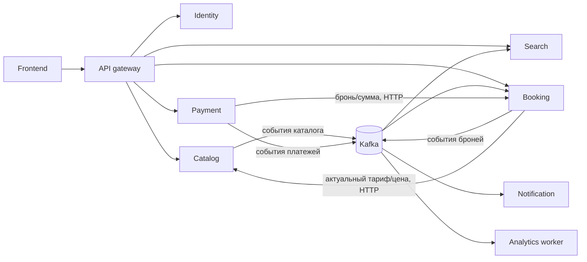
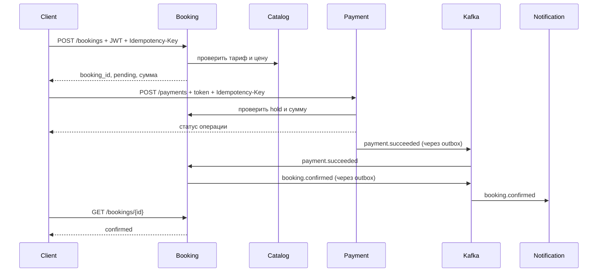

# Архитектура backend для поиска и бронирования отелей (R1)

Этот документ — **предлагаемая структура**, а не готовая реализация. Основа: приложенное ТЗ «Яндекс Путешествия R1: поиск и бронирование»; выбранный стек: Python, FastAPI, SQLAlchemy, Pydantic, pytest, PostgreSQL и Kafka. SQL-схема в ТЗ описывает сущности вместе; при разделении на сервисы таблицы распределяются по владельцам данных.

## 1. Границы сервисов

| Сервис | Что хранит и за что отвечает | Основные HTTP-маршруты | События Kafka |
| --- | --- | --- | --- |
| `gateway` | Единая точка входа: маршрутизация, общие заголовки, лимиты запросов, `correlation_id`. Собственной бизнес-БД нет. | Публичное `/api/v1/*`, при сбросе фильтров `/api/v1/analytics/events` | Передаёт событие сброса фильтров в аналитический поток. |
| `identity-service` | Пользователи, хеши паролей, refresh-сессии, деактивация аккаунта, избранное. Уникальность `(user_id, hotel_id)` для избранного. | `/auth/*`, `/users/me`, `/users/me/favorites`, `/favorites/*` | `user.deactivated`, при необходимости `favorite.added`. |
| `catalog-service` | Отели, конкретные физические номера (включая `rooms_count` — число комнат внутри номера), тарифы, фото и отзывы, справочники фильтров. Административное изменение каталога. | `/hotels/{id}`, `/rooms/{id}`, `/filters`, внутренний запрос актуального тарифа/цены | `hotel.changed`, `room.changed`, `rate.changed`, `hotel.deactivated`. |
| `search-service` | Своя поисковая проекция каталога и доступности: город, даты, гости, число комнат внутри номера, стиль, цель, теги, сортировка, страницы и `total`. | `/hotels/search` | Читает изменения каталога и броней. |
| `booking-service` | Одна бронь на один физический номер: история статусов, временное удержание номера на даты, проверка пересечений, снимок цены, ключи идемпотентности. **Единственный владелец доступности для подтверждения брони.** | `/bookings`, `/bookings/{id}`, `/users/me/bookings`, `/bookings/{id}/cancel`; внутренние запросы статуса/суммы | `booking.held`, `booking.confirmed`, `booking.cancelled`, `booking.expired`; читает результат оплаты и изменения каталога. |
| `payment-service` | Платежи, их идемпотентность, интеграция с платёжным провайдером, обработка webhook, возвраты. Полный номер карты не хранит. | `/payments`, внутренний webhook провайдера | `payment.succeeded`, `payment.failed`, `payment.refunded`. |
| `notification-service` | Настройки уведомлений, задачи отправки и журнал доставки подтверждений/напоминаний. | `/users/me/notification-preferences` и внутренний API при необходимости | Читает `booking.confirmed` и `booking.cancelled`. |
| `analytics-worker` | Принимает технические события для аналитического хранилища; для локального R1 может хранить их в собственной БД. | Публичного API нет | Читает `search.filters_reset`. |

Для R1 этого достаточно. **Сравнение 2–3 отелей** можно собрать на клиенте из ответов каталога; оётдельный сервис здесь не нужен. **Сброс фильтров** — действие интерфейса: город и даты сохраняются, остальные query-параметры очищаются; frontend отправляет событие в gateway, тот публикует `search.filters_reset` в `analytics.events.v1`, а `analytics-worker` его сохраняет или пересылает в систему аналитики. Отзывы пока живут в каталоге; если их запись и модерация сильно вырастут, их можно выделить позже. Избранное оставлено у пользователя, поскольку это небольшие персональные данные с простой записью.



### Владение данными

- У каждого сервиса своя БД или, для локальной разработки, **отдельная схема PostgreSQL и отдельный пользователь БД**. Чужие таблицы напрямую не читаются и не изменяются. Миграции Alembic принадлежат конкретному сервису.
- В исходной SQL-схеме ТЗ `bookings.room_id` — **FK на `rooms.room_id`**; аналогично заданы ссылки на пользователя, отель и тариф. Каждая строка `rooms` в принятой модели — **один конкретный физический номер**. В предложенном разделении `bookings` и `rooms` находятся в разных БД, поэтому физический FK между ними не создать: `room_id` остаётся логической ссылкой на запись каталога. Booking проверяет её существование и принадлежность отелю через API catalog, а событиями получает последующие изменения. Если принципиально нужен FK, таблицы `rooms` и `bookings` должны находиться в одной границе владения БД; тогда разделение catalog/booking надо пересмотреть. Физическое удаление отеля/номера с историей броней заменяется деактивацией.
- `search-service` держит копию данных для чтения. Его ответ может отставать от каталога и броней. Перед созданием брони `booking-service` проверяет актуальный тариф, цену и доступность у владельцев данных.
- JWT access/refresh выдаёт `identity-service`. Публичный поиск и карточки не требуют JWT; избранное, бронь и оплата требуют проверку прав. Сервисы проверяют подпись и срок JWT, а также принадлежность ресурса пользователю, даже если запрос прошёл через gateway.
- В Kafka передаются идентификаторы и минимальные нужные данные. Пароли, refresh-токены, платёжные токены и полные карточные данные в события не попадают.

## 2. Предлагаемая структура репозитория

Один репозиторий упрощает первый запуск и работу с общей библиотекой. Каждый сервис собирается и развёртывается отдельно. Ниже **план файлов**, а не уже созданный код.

```text
yandex_travel/
├── ARCHITECTURE.md
├── pyproject.toml                 # общие настройки инструментов; зависимости сервисов отдельно
├── .env.example                   # только имена параметров и безопасные примеры
├── compose.yaml                   # Kafka, PostgreSQL, сервисы для локальной разработки
├── infra/
│   ├── kafka/topics.md            # имена топиков, ключи, группы, retention, DLQ
│   └── postgres/init/             # отдельные БД/схемы и роли для dev
├── shared/                         # устанавливаемый внутренний Python-пакет
│   ├── pyproject.toml
│   └── src/travel_shared/
│       ├── config.py               # базовые настройки подключения
│       ├── kafka/
│       │   ├── factory.py          # KafkaClientFactory: создание и закрытие клиента
│       │   ├── producer.py         # BaseProducer: отправка и сериализация
│       │   ├── consumer.py         # BaseConsumer: цикл чтения и commit offset
│       │   ├── envelope.py         # Pydantic-модель общей оболочки события
│       │   ├── registry.py         # выбор обработчика по типу/версии события
│       │   └── errors.py           # классы временных/неисправимых ошибок
│       ├── outbox/
│       │   ├── model.py            # общая схема полей outbox; таблица в БД сервиса
│       │   └── publisher.py        # фоновая публикация из outbox
│       └── observability/
│           ├── logging.py
│           └── tracing.py
├── services/
│   ├── gateway/
│   │   ├── pyproject.toml
│   │   ├── Dockerfile
│   │   ├── src/gateway/
│   │   │   ├── main.py
│   │   │   ├── outbox_worker.py     # публикация событий identity из outbox
│   │   │   ├── config.py
│   │   │   ├── routes.py           # маршрутизация к API сервисов
│   │   │   └── clients/            # HTTP-клиенты с таймаутами
│   │   └── tests/test_routes.py
│   ├── identity_service/
│   │   ├── pyproject.toml
│   │   ├── Dockerfile
│   │   ├── alembic/versions/
│   │   ├── src/identity_service/
│   │   │   ├── main.py
│   │   │   ├── outbox_worker.py     # публикация событий catalog из outbox
│   │   │   ├── config.py
│   │   │   ├── db.py
│   │   │   ├── api/{auth,users,favorites}.py
│   │   │   ├── models/{user,refresh_session,favorite,outbox}.py
│   │   │   ├── schemas/{auth,user,favorite}.py
│   │   │   ├── repositories/{users,favorites}.py
│   │   │   ├── services/{auth,profiles,favorites}.py
│   │   │   ├── clients/catalog.py  # проверка существования отеля
│   │   │   └── events/producer.py
│   │   └── tests/{test_auth,test_favorites}.py
│   ├── catalog_service/
│   │   ├── pyproject.toml
│   │   ├── Dockerfile
│   │   ├── alembic/versions/
│   │   ├── src/catalog_service/
│   │   │   ├── main.py
│   │   │   ├── config.py
│   │   │   ├── db.py
│   │   │   ├── api/{hotels,rooms,rates,filters,internal_quotes}.py
│   │   │   ├── models/{hotel,room,rate,photo,review,filter_value,outbox}.py
│   │   │   ├── schemas/{hotel,room,rate,filter}.py
│   │   │   ├── repositories/{hotels,rooms,rates}.py
│   │   │   ├── services/{catalog,pricing,quotes}.py
│   │   │   └── events/producer.py
│   │   └── tests/{test_catalog,test_quotes}.py
│   ├── search_service/
│   │   ├── pyproject.toml
│   │   ├── Dockerfile
│   │   ├── alembic/versions/
│   │   ├── src/search_service/
│   │   │   ├── main.py
│   │   │   ├── worker.py           # отдельный процесс Kafka consumer
│   │   │   ├── config.py
│   │   │   ├── db.py
│   │   │   ├── api/search.py
│   │   │   ├── models/{hotel_document,availability,processed_event}.py
│   │   │   ├── schemas/search.py
│   │   │   ├── repositories/search.py
│   │   │   ├── services/search.py
│   │   │   └── events/{catalog_handler,booking_handler}.py
│   │   └── tests/{test_search,test_projection}.py
│   ├── booking_service/
│   │   ├── pyproject.toml
│   │   ├── Dockerfile
│   │   ├── alembic/versions/
│   │   ├── src/booking_service/
│   │   │   ├── main.py
│   │   │   ├── worker.py           # Payment events и события каталога
│   │   │   ├── outbox_worker.py     # публикация событий booking из outbox
│   │   │   ├── config.py
│   │   │   ├── db.py
│   │   │   ├── api/{bookings,internal}.py
│   │   │   ├── models/{booking,room_hold,idempotency,outbox,processed_event}.py
│   │   │   ├── schemas/booking.py
│   │   │   ├── repositories/{bookings,availability}.py
│   │   │   ├── services/{booking,availability,expiration}.py
│   │   │   ├── clients/{catalog,identity}.py
│   │   │   └── events/{payment_handler,catalog_handler,producer}.py
│   │   └── tests/{test_booking,test_concurrent_booking,test_payment_events}.py
│   ├── payment_service/
│   │   ├── pyproject.toml
│   │   ├── Dockerfile
│   │   ├── alembic/versions/
│   │   ├── src/payment_service/
│   │   │   ├── main.py
│   │   │   ├── outbox_worker.py     # публикация событий payment из outbox
│   │   │   ├── config.py
│   │   │   ├── db.py
│   │   │   ├── api/{payments,provider_webhook}.py
│   │   │   ├── models/{payment,idempotency,outbox}.py
│   │   │   ├── schemas/payment.py
│   │   │   ├── repositories/payments.py
│   │   │   ├── services/payments.py
│   │   │   ├── clients/{booking,provider}.py
│   │   │   └── events/producer.py
│   │   └── tests/{test_payment,test_duplicate_webhook}.py
│   ├── notification_service/
│   │   ├── pyproject.toml
│   │   ├── Dockerfile
│   │   ├── alembic/versions/
│   │   ├── src/notification_service/
│   │   │   ├── main.py             # API настроек уведомлений
│   │   │   ├── worker.py           # Kafka consumer и отправка уведомлений
│   │   │   ├── config.py
│   │   │   ├── db.py
│   │   │   ├── api/preferences.py
│   │   │   ├── models/{preference,delivery,processed_event}.py
│   │   │   ├── services/{confirmation,reminder}.py
│   │   │   ├── clients/{identity,delivery_provider}.py
│   │   │   └── events/booking_handler.py
│   │   └── tests/test_notifications.py
│   └── analytics_worker/
│       ├── pyproject.toml
│       ├── Dockerfile
│       ├── alembic/versions/
│       ├── src/analytics_worker/
│       │   ├── worker.py
│       │   ├── config.py
│       │   ├── db.py
│       │   ├── models/{analytics_event,processed_event}.py
│       │   └── events/search_handler.py
│       └── tests/test_filter_reset.py
├── tests/
│   ├── contracts/                 # совместимость HTTP и event-схем
│   └── e2e/                       # путь поиск → бронь → платёж → подтверждение
└── docs/
    ├── api.md
    ├── events.md
    └── local-development.md
```

Фигурные скобки в дереве сокращают перечень файлов: `api/{auth,users}.py` означает два файла. `src/`, `tests/`, `models/`, `schemas/`, `repositories/`, `services/`, `api/` и `events/` — **папки внутри одного сервиса**. У каждого сервиса свои зависимости и миграции. Общие бизнес-модели SQLAlchemy в `shared` не кладём: иначе любое изменение таблицы каталога заставит менять остальные сервисы. В `shared` остаются технические интерфейсы и стабильные контракты событий.

## 3. Kafka с нуля: что происходит

1. **Producer** отправляет запись в **topic** — именованный поток событий. Например, каталог публикует `rate.changed` в `catalog.events.v1`.
2. Topic состоит из **partitions**. Записи с одинаковым `key`, например `booking_id`, направляются в одну partition; Kafka сохраняет порядок внутри partition. Общего порядка между всеми partitions нет.
3. **Consumer** читает записи. Его **consumer group** распределяет partitions между экземплярами одного логического обработчика. Если `search-service` и `notification-service` должны получить одно событие, у них разные `group_id`. Два экземпляра `search-service` с одним `group_id` делят работу между собой.
4. У записи есть **offset** — позиция в partition. После успешной обработки consumer сохраняет следующий offset. Если процесс упал до commit, запись может прийти ещё раз.
5. Поэтому обработчики должны быть **идемпотентными**: повторное `payment.succeeded` не подтверждает бронь повторно и не вызывает повторную отправку письма. Для этого в БД потребителя хранится `event_id` в `processed_events` с уникальным индексом; изменение бизнес-данных и запись `event_id` делаются в одной транзакции, затем подтверждается offset.

Эти свойства относятся к Kafka и его клиенту; ограничение порядка и работа consumer groups описаны в [документации Apache Kafka](https://kafka.apache.org/41/design/design/) и [aiokafka](https://aiokafka.readthedocs.io/en/stable/consumer.html). Для Python/FastAPI подойдёт асинхронный клиент `aiokafka`; его [пример producer/consumer](https://aiokafka.readthedocs.io/en/stable/) и [ручной commit](https://aiokafka.readthedocs.io/en/stable/examples/manual_commit.html) полезны перед реализацией.

### Какие топики нужны сначала

| Topic | Публикует | Типы событий | `key` | Читает |
| --- | --- | --- | --- | --- |
| `catalog.events.v1` | catalog | `hotel.changed`, `room.changed`, `rate.changed`, `hotel.deactivated` | `hotel_id` для изменений отеля; `room_id` для номера/тарифа | search, booking; identity для очистки устаревшего избранного |
| `booking.events.v1` | booking | `booking.held`, `booking.confirmed`, `booking.cancelled`, `booking.expired` | `booking_id` | search, notification |
| `payment.events.v1` | payment | `payment.succeeded`, `payment.failed`, `payment.refunded` | `booking_id` | booking |
| `identity.events.v1` | identity | `user.deactivated` | `user_id` | notification; остальные — только при необходимости |
| `analytics.events.v1` | gateway | `search.filters_reset` | `session_id` или анонимный correlation ID | analytics-worker |

Названия topic и событий — договорённость проекта, их следует закрепить в `docs/events.md`. Суффикс `.v1` означает версию контракта потока, а не необходимость создавать новый topic при каждой правке поля. `group_id` выбираем по назначению обработчика, например `search-catalog-v1`, `search-booking-v1`, `booking-payment-v1`, `notification-booking-v1`. Два разных назначения не должны случайно делить один `group_id`.

Пример **формата события**, не код приложения:

```json
{
  "event_id": "c4176596-4cf2-431f-a36a-142879ba2de1",
  "event_type": "payment.succeeded",
  "event_version": 1,
  "occurred_at": "2026-10-03T10:00:00Z",
  "aggregate_id": "b7a8cfd5-526c-4f9f-9a52-406aa92fb54d",
  "correlation_id": "5b6717d9-8c32-46dc-b0c1-60817ea20273",
  "payload": {
    "booking_id": "b7a8cfd5-526c-4f9f-9a52-406aa92fb54d",
    "payment_id": "625a7157-d81a-4e17-8550-1d1436699367",
    "amount": "14800.00",
    "currency": "RUB"
  }
}
```

Для этого события Kafka `key = booking_id`. Денежная сумма передаётся строкой, а в Python проверяется через `Decimal`. Оболочку проверяет `shared`, а конкретный `payload` — Pydantic-схема сервиса-получателя. При несовместимом изменении нужен новый `event_version`; старые события могут оставаться в Kafka до конца retention.

### Зачем нужны `shared` и outbox

- `KafkaClientFactory` (тот самый общий **конструктор**) создаёт клиент из настроек: `bootstrap_servers`, безопасность, таймауты, сериализация; закрывает соединение при остановке процесса. Это не конструктор всех микросервисов.
- `BaseProducer` знает, как валидировать оболочку, выбрать topic/key и отправить запись. `BaseConsumer` знает, как читать, валидировать, вызвать зарегистрированный обработчик, классифицировать ошибку и подтвердить offset. Их наследники в сервисах знают свои события и бизнес-логику.
- В типичном API нельзя надёжно выполнить «записать бронь в PostgreSQL и сразу отправить Kafka-событие» как одну транзакцию: база может сохраниться, а отправка не состояться. Поэтому сервис в **одной транзакции БД** записывает бизнес-изменение и запись в свою таблицу `outbox`; отдельный publisher позже отправляет outbox в Kafka и помечает доставленным. Это [transactional outbox](https://debezium.io/documentation/reference/stable/transformations/outbox-event-router.html). Для первого релиза достаточно собственного polling publisher; Debezium можно добавить позже.
- Схема шага без привязки к реализации: `BEGIN → сохранить бронь + outbox → COMMIT → outbox_worker → Kafka → consumer → сохранить эффект + processed_event → COMMIT БД → commit offset`. При падении на любом шаге повтор допускается и должен дать тот же итог.
- Повторная отправка из outbox возможна после сбоя, поэтому `processed_events` и уникальные ключи остаются обязательными. Гарантии Kafka о «exactly once» сами по себе не делают запись в PostgreSQL или вызов платёжного провайдера однократными — см. [семантику доставки Kafka](https://kafka.apache.org/41/design/design/).
- Consumer лучше запускать **отдельным процессом `worker.py`**, а не внутри каждого FastAPI worker: число HTTP-процессов тогда не меняет случайно число потребителей. У каждого процесса свой SQLAlchemy session/`AsyncSession`, не общий на несколько параллельных задач ([SQLAlchemy](https://docs.sqlalchemy.org/en/20/orm/session_basics.html)).
- Для изменений каталога полезно включить в payload версию конкретной сущности (`entity_version` или `updated_at`) и применять в проекции только более новые данные: события об отеле и его тарифах могут находиться в разных partitions, поэтому одного глобального порядка для них нет. Проекция доступности хранит занятые интервалы по `room_id` и состояние каждого `booking_id`: переход `held → confirmed` **не** создаёт второе удержание.

### Ошибки и повторные попытки

- Временная ошибка (БД/сеть недоступна): повторить обработку с ограничением попыток и задержкой; offset подтверждать лишь после успешной фиксации результата. Если использовать отдельный retry topic, нужно продумать порядок событий одного ключа.
- Неисправимое событие (неподдерживаемая версия, неверный payload): отправить исходное событие и причину в `*.dlq` (dead-letter queue), поднять сигнал мониторинга и только после успешной записи в DLQ сдвинуть offset. DLQ требуется разбирать и переигрывать осознанно.
- Следить за **consumer lag** (отставанием), размером outbox, числом ошибок/DLQ, временем `pending`-броней. `correlation_id` помогает связать HTTP-запрос и последующие события в логах.
- В локальной среде допустим один broker и один экземпляр сервиса. Для окружения с отказоустойчивостью нужны отдельные настройки репликации и подтверждения записи; их задают после выбора инфраструктуры.

## 4. Путь пользователя и движение данных

### Поиск и выбор

1. Клиент отправляет `GET /api/v1/hotels/search` с городом, датами, гостями, желаемым числом комнат **внутри номера** (`rooms_count`) и фильтрами. JWT не нужен.
2. Gateway передаёт запрос `search-service`. Тот читает свою проекцию, возвращает `items` и `total`. Значения стилей/целей клиент получает через `GET /api/v1/filters` у каталога; в R1 это «Светлый», «Минимализм», «Лофт» и «Отдых», «Фотосессия», «День рождения», но frontend не хранит их как постоянный список.
3. Каталог изменился → событие в Kafka → `search-service` обновил проекцию. Поэтому выдача может немного отставать. Просмотр карточки, номера и тарифа идёт из каталога; доступность и цену перед бронированием проверяют заново.
   Каталог сообщает booking о создании, изменении или деактивации конкретного номера; booking учитывает эти изменения при новой брони, не отменяя уже подтверждённые брони автоматически.
4. До авторизации клиент сохраняет выбранные `hotel_id`, `room_id`, `rate_id`, даты, гостей и значение `rooms_count` в состоянии приложения/защищённом короткоживущем контексте. После login продолжает с теми же ID, но актуальность тарифа и доступности номера проверяется снова. Токены и чувствительные данные в URL не кладутся.

### Бронь, оплата, подтверждение

1. `POST /api/v1/bookings` с JWT и `Idempotency-Key` приходит в booking. Сервис проверяет пользователя, получает от catalog актуальную котировку/версию тарифа, сверяет `rooms_count` с числом комнат внутри выбранного номера, фиксирует цену и в своей БД **атомарно** удерживает один `room_id` на даты (`pending`, срок удержания), сохраняет ключ запроса и запись outbox `booking.held`. Повтор с тем же ключом и тем же телом возвращает ту же бронь; тот же ключ с другим телом — ошибка.
2. Клиент вызывает `POST /api/v1/payments` с JWT, `booking_id`, `payment_method`, `payment_token` и отдельным `Idempotency-Key`. Payment через внутренний HTTP-запрос проверяет активность удержания и точную сумму, обращается к провайдеру, хранит его идентификатор и статус. Платёжный токен уходит провайдеру по защищённому каналу; в Kafka он не публикуется.
3. Провайдер сообщает результат (ответом API или webhook). Payment проверяет подлинность webhook, повторную доставку и записывает результат + outbox `payment.succeeded`/`payment.failed` одной транзакцией.
4. Booking читает `payment.succeeded`, повторно проверяет переход статуса, переводит бронь в `confirmed` и публикует `booking.confirmed`. Notification после этого отправляет подтверждение, search обновляет доступность. При неуспехе/истечении срока booking освобождает удержание и публикует соответствующее событие. Отмена после оплаты требует отдельного правила возврата по тарифу.
5. Клиент получает текущий статус через `GET /api/v1/bookings/{id}`. Оплата может завершиться позже HTTP-ответа, поэтому `pending` — допустимый промежуточный ответ; подтверждение появляется после обработки события.



### Что означает `rooms_count` и как бронировать несколько номеров

Принятая модель: `room_id` указывает на **один физический номер**, а `rooms_count` означает **сколько отдельных комнат внутри этого номера** (например, двухкомнатный семейный номер). Значит, `rooms_count` не является числом бронируемых номеров. Один `Booking` всегда связан с одним `room_id`; если семья берёт два физических номера, создаются **две записи `Booking`**, каждая со своим `booking_id` и `room_id`.

Это уточнение меняет смысл `rooms_count` по сравнению с первоначальным текстом ТЗ. Чтобы модель была согласованной, у `Room` нужно добавить атрибут `rooms_count` для поиска и проверки; в `Booking` одноимённое поле может хранить снимок характеристики номера на момент оформления, но источником истины является catalog, а не число, присланное клиентом. В документации API следует прямо назвать поле «количество комнат внутри номера», чтобы его не путали с количеством одновременно бронируемых номеров.

Booking не допускает пересекающихся активных удержаний/броней для одной пары `room_id` и интервала дат. Проверка и установка удержания должны происходить под защитой транзакции БД (например, ограничением на пересекающиеся диапазоны дат). Поисковая проекция помогает отбирать варианты, но **последнее решение** о доступности принимает booking. Если платёж прошёл после истечения удержания и номер уже занят, нужен возврат/ручной разбор и сигнал мониторинга.

Если два номера оформляются **одним действием**, booking должен создать две записи в одной транзакции, чтобы не получить одну успешную и одну неуспешную бронь. Для общей оплаты этих броней понадобится отдельный `booking_group_id`/«заказ» и связь платежа с группой; текущая схема ТЗ (`payments.booking_id`) покрывает только отдельную оплату каждой брони. Это отдельное решение для API и платежного сценария до реализации семейного заказа.

## 5. Порядок разработки

1. Закрепить описанный смысл `Room` и `rooms_count` в API/миграциях, затем определить срок удержания, статусы броней/платежей, источник окончательной цены, условия отмены, сценарий общей оплаты нескольких броней и правило мультивыбора фильтров (в ТЗ предложено OR внутри группы и AND между группами, но это ещё требует подтверждения).
2. Поднять локально PostgreSQL и Kafka; создать отдельные схемы/роли, темы и конфигурацию. Начать с `shared` (оболочка события, producer/consumer, outbox) и одного пробного события `hotel.changed`.
3. Сделать identity + catalog + search: гостевой поиск, карточки, фильтры, избранное, login и восстановление выбора. Search projection можно сначала строить PostgreSQL, без отдельного поискового движка.
4. Добавить booking: котировку тарифа, транзакционное удержание, уникальный `Idempotency-Key`, истечение удержания и защиту от конкурентной продажи.
5. Добавить payment через тестового провайдера, обработку webhook, события результата, подтверждение, уведомления и отмену/возврат по согласованным правилам.
6. Проверить не только обычный путь, но и повторную доставку Kafka, двойной HTTP-запрос, параллельные бронирования последнего места, задержанный webhook, падение после записи outbox и восстановление consumer. Для этого нужны pytest unit/интеграционные тесты и один сквозной сценарий.

Короткое правило выбора транспорта: **HTTP — когда вызывающему нужен ответ сейчас; Kafka — когда сервис сообщает уже произошедший факт нескольким независимым получателям.** Запись брони и финансовый результат всегда подтверждаются состоянием их владельцев в БД, а не предположением о доставке сообщения.