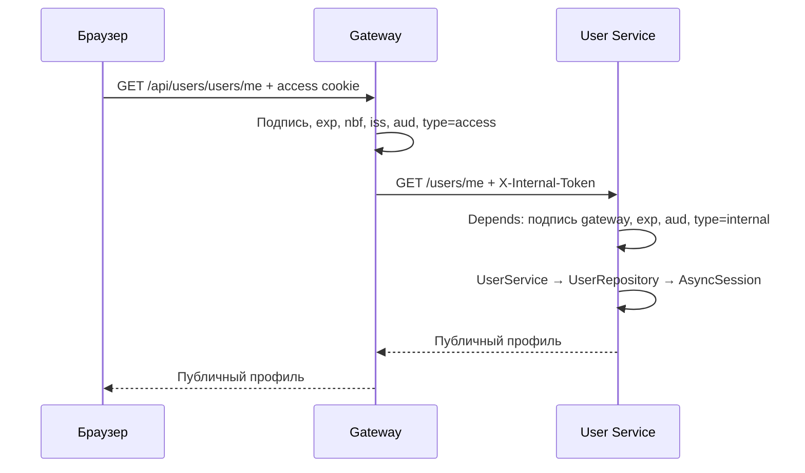

# Авторизация и устройство проекта

Рабочие сервисы — gateway и user_service. Публичная точка входа — gateway.
В Docker у user-service нет порта, опубликованного на хост.

## Кто выдаёт и проверяет токены

| Компонент | Ответственность |
| --- | --- |
| user_service/services/users.py | Регистрация, хеширование пароля, операции со своим профилем |
| user_service/services/auth.py | Проверка пароля, создание refresh-сессии, ротация и отзыв |
| user_service/api/auth.py и cookies.py | Установка и удаление cookies после успешного коммита |
| shared/auth/service.py | Криптография пользовательских JWT и CSRF; без HTTP и БД |
| gateway/services/auth.py | Проверка access JWT и CSRF перед закрытым запросом, подпись внутреннего JWT |
| shared/auth/dependencies.py | Проверка внутреннего JWT через Depends в сервисе |
| Роут и сервис ресурса | Проверка прав: пользователь работает только со своим профилем |

Приватный ключ auth есть только у user-service; gateway получает его публичный ключ.
Приватный ключ gateway есть только у gateway; сервисы получают его публичный ключ.
Клиентские X-Internal-Token, X-User-Id и аналогичные заголовки gateway удаляет.

## Регистрация и вход

1. POST /api/users/auth/register принимает email, password, name, phone.
2. UserService хеширует пароль через Argon2 и сохраняет пользователя в транзакции.
3. Ответ — 201 с публичным профилем. Автоматического входа после регистрации нет.
4. POST /api/users/auth/login проверяет пароль и создаёт UUID refresh-сессии.
5. JWT содержат этот UUID в sid. В БД хранится SHA-256 refresh-токена.
6. После коммита роут устанавливает access_token и refresh_token с HttpOnly.
   Cookie csrf_token доступна JavaScript для передачи значения в X-CSRF-Token.

Cookies имеют Path=/, SameSite=lax, без Domain. В HTTPS нужно COOKIE_SECURE=true.
CSRF подписан HMAC и привязан к sid. Пароли и хеши не возвращаются в HTTP-ответах.

## Каждый закрытый запрос

Для POST/PATCH/PUT/DELETE gateway проверяет разрешённый Origin и X-CSRF-Token:
заголовок должен совпадать с csrf-cookie и иметь подпись для текущего sid.
Внутренний JWT действует 60 секунд и не возвращается браузеру.
В закрытые сервисы пользовательские cookies не передаются.

Публичные маршруты перечислены явно в gateway/config.py. Новый маршрут по умолчанию
закрыт. Внутренний сервис подключает Depends(get_internal_principal), а при старте
задаёт app.state.internal_jwt и app.state.service_name. Повторной проверки в middleware нет.

## Обновление и выход

После 401 клиент может один раз вызвать POST /api/users/auth/refresh с refresh-cookie
и X-CSRF-Token, затем повторить исходный запрос. Одновременные запросы клиента должны
использовать один общий процесс обновления токенов.

Gateway пропускает refresh/logout без access JWT, проверяя Origin. User-service
проверяет подпись refresh JWT, срок, type, CSRF и сессию в БД: sid, владельца,
хеш, expires_at, revoked_at. Ротация — один условный UPDATE по старому хешу.
Из двух одновременных обновлений проходит одно; старый refresh после ротации даёт 401.
Новые cookies выставляются только после коммита. Срок refresh-сессии скользящий:
по умолчанию ещё 30 дней после обновления.

Logout использует refresh-cookie и работает при истёкшем access. Он отзывает
предъявленный текущий refresh и удаляет cookies. Повторный logout с тем же
подписанным refresh возвращает 204; истёкший или невалидный refresh даёт 401.

**Access JWT после logout может действовать до истечения своих 15 минут.**
Gateway не обращается в БД на каждом запросе. Удаление пользователя удаляет сессии
через FK CASCADE, и его профиль сразу даёт 404. Будущие другие сервисы могут
принимать старый access до истечения срока. Для мгновенного отзыва во всех сервисах
нужна отдельная проверка состояния сессии в gateway: introspection или общий реестр.

## Зависимости, транзакции и shared

Depends(get_session) использует Database.get_session(): одна AsyncSession на запрос,
закрытие гарантировано. Зависимости собирают UserService с UserRepository или
AuthService с UserRepository и SessionRepository на одной сессии.

Каждая операция сервиса открывает async with session.begin(). Успех означает commit
до возврата в роут, ошибка — rollback. Репозитории не делают commit.
Ошибки предметной области наследуют ApplicationError и возвращают code/detail.
Неизвестные ошибки дают 500 без внутренних данных.

shared/auth содержит JWT, CSRF и внутреннюю зависимость; database.py и db/repository.py
отвечают за SQL; errors.py и fastapi/factory.py — за HTTP и ошибки.
Kafka и outbox импортируются отдельно, устанавливаются через shared[messaging].
Импорт shared не регистрирует inbox/outbox. Миграция user-service создаёт только
users и refresh_sessions.

Основа: [транзакции SQLAlchemy](https://docs.sqlalchemy.org/en/20/orm/extensions/asyncio.html),
[подписанный double-submit CSRF OWASP](https://cheatsheetseries.owasp.org/cheatsheets/Cross-Site_Request_Forgery_Prevention_Cheat_Sheet.html),
[хеширование паролей FastAPI](https://fastapi.tiangolo.com/tutorial/security/oauth2-jwt/).
