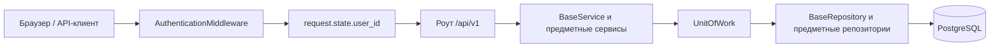

# Архитектура монолита

Схема ветки main. Предыдущая микросервисная реализация находится в feat/ms.

UOW создаёт и закрывает AsyncSession; все его репозитории работают в одной транзакции.
Сервис явно вызывает commit для успешной записи. При исключении или отсутствии commit
UOW откатывает изменения. В роуты сессии не передаются.

Роуты login/refresh устанавливают access, refresh и CSRF cookies. Middleware проверяет
JWT и CSRF; при закрытом доступе дополнительно читает активность пользователя и сессии
через отдельный короткий UOW. Затем роут получает подтверждённый user_id из state.
Для бизнес-операции сервис открывает собственный UOW.

Бизнес-ошибки и HTTP-обработчики находятся вместе в app/errors.py. Middleware
использует тот же формат ответа: code и detail. Неизвестные ошибки дают 500;
внутренние данные не возвращаются клиенту.

При бронировании блокируется Room. Порядок блокировок для пользовательских
операций: User → Room → Booking → Payment. Это сериализует создание брони,
оплату и отмену, а уникальные ключи в БД защищают от дублей запросов.

Описания и цены фиксируются в snapshot брони. Деактивация отеля, номера, тарифа
или пользователя не уничтожает историю. Поиск доступен гостям, избранное и бронь —
пользователю, изменение каталога — только администратору.

Подробности и ограничения: [README.md](README.md).
